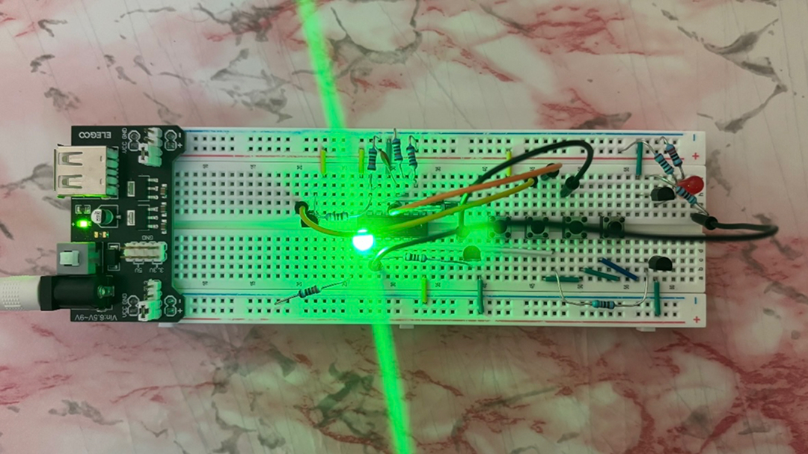
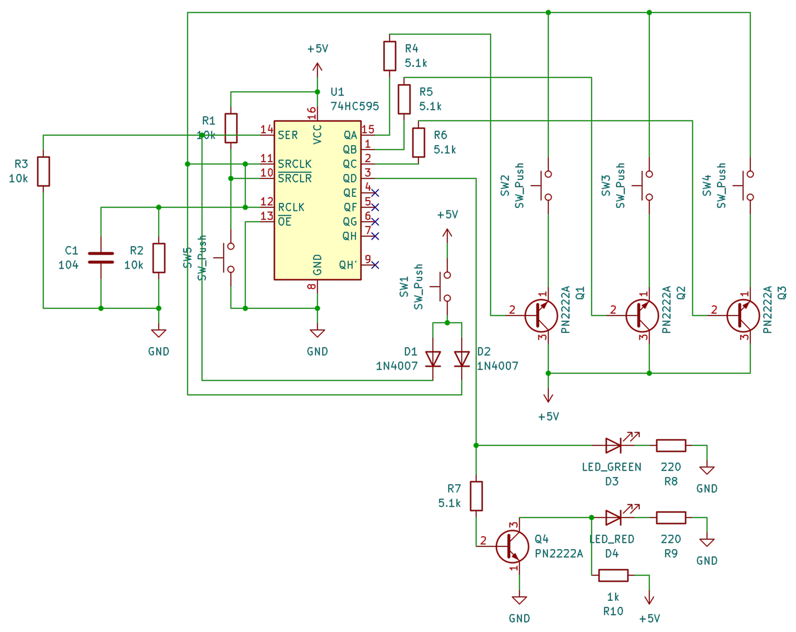

# 4-Bit Pincode
A 4-digit sequential passcode lock built on a breadboard using no microcontroller, no firmware, and zero code.

## How it works
The circuit uses a single 74HC595 shift register to track your progress through the code:

1. Button 1 (S1) runs +5V through two 1N4007 steering diodes to pulse the clock and pull the serial data line high at the same time. This puts a `1` into the register and arms the first stage.
2. Buttons 2, 3, and 4 do not connect to power directly. Their +5V line is gated through PN2222 NPN transistors controlled by the output of the previous stage. If you press them out of order, the transistor base is sitting at 0V, so pressing the button does nothing.
3. Once all four are pressed in sequence (S1 -> S2 -> S3 -> S4), the `1` bit reaches Q3 and turns on the green LED.
4. An extra PN2222 acts as an inverter on the red LED: it stays on by default while locked, and shuts off as soon as the green LED turns on.

## Files
- `kicad/`: schematic (`.kicad_sch`), project file (`.kicad_pro`), and PCB files
- `bom.csv`: complete bill of materials with footprints, values, and part counts

## Hardware
- 74HC595: 8-bit shift register (handles the state machine)
- PN2222A (x4): 3 for gating buttons 2–4, 1 for the red LED inverter
- 1N4007 (x2): steering diodes for button 1
- LEDs: 1 green (unlocked), 1 red (locked)
- Buttons (x5): 4 passcode inputs, 1 reset button
- Resistors: 10k pull-ups/pull-downs, 5.1k base limiters, 220Ω LED limiters, 1k inverter pull-up
- 100nF (104) ceramic capacitor: clock line debounce filter

## How to use
- Hit the reset button: Red LED turns on, Green LED is off.
- Press `S1` -> `S2` -> `S3` -> `S4` in order.
- Green LED lights up and Red LED turns off.
- Press the reset button at any point to wipe the register back to zero and relock.

## Notes
- Made for [Hack Club's Embassy YSWS](https://embassy.hackclub.com).
